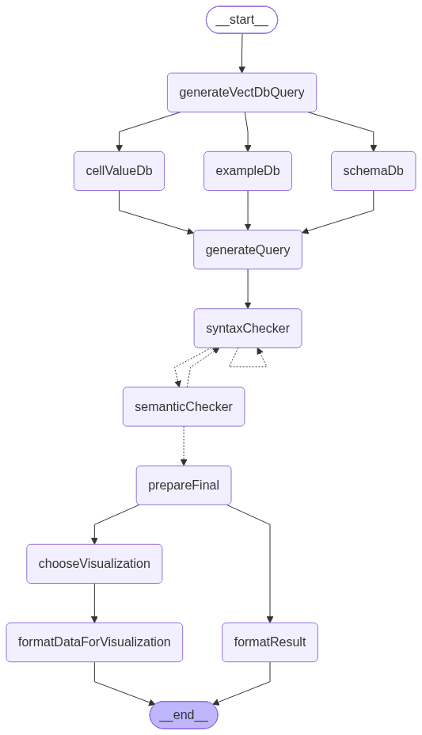

# SQLAgent: a self-correcting Text-to-SQL LangGraph agent with visualization


SQLAgent is a natural-language analytics application for an ice cream shop database. A user submits a question, the agent retrieves the context needed to understand the database, generates SQL, validates and repairs the query, and returns a natural-language answer. When the result is suitable for visual analysis, the agent also returns a chart.

The backend is built around a LangGraph Text-to-SQL workflow with retrieval-augmented generation (RAG), two independent SQL correction stages, and a Next.js chat interface.

## Table of contents

- [Features](#features)
- [Architecture](#architecture)
- [RAG context enrichment](#rag-context-enrichment)
- [Database: a cool ice cream shop](#database-a-cool-ice-cream-shop)
- [Visualization](#visualization)
- [Technology stack](#technology-stack)
- [Getting started](#getting-started)
- [Project structure](#project-structure)
- [API contract](#api-contract)
- [Customization](#customization)
- [Notes and limitations](#notes-and-limitations)
- [Contributing](#contributing)
- [Contact](#contact)

## Features

- Ask analytical questions in plain English.
- Retrieve database schema, SQL examples, and categorical values from Qdrant.
- Generate SQLite SQL with an LLM.
- Repair executable SQL through a syntax correction loop.
- Check whether the SQL answers the original question through a semantic correction loop.
- Format database results as a human-readable response.
- Select and generate bar, horizontal bar, line, pie, or scatter visualizations when appropriate.
- Run follow-up questions in a conversation-oriented interface.

## Architecture



The Text-to-SQL graph follows this flow:

1. `generateVectDbQuery` decomposes the question into retrieval queries for schema, examples, and values.
2. Three retrieval branches query Qdrant in parallel:
   - `table_schemas`
   - `sql_qa_pairs`
   - `categorical_values`
3. `generateQuery` combines the retrieved context and generates a SQL candidate.
4. `syntaxChecker` executes the SQL against SQLite. If execution fails, the LLM repairs the query and retries, up to three syntax repairs.
5. `semanticChecker` evaluates whether the query matches the user's intent. It can apply one semantic correction and sends the corrected query back through syntax checking.
6. The finalized query fans out into two paths:
   - `formatResult` creates the natural-language answer.
   - `chooseVisualization` decides whether a chart is useful, and `formatDataForVisualization` prepares its data.

The API accepts a natural-language `question` and returns an object containing `sql`, `result`, and an optional `chartConfig`.

## RAG context enrichment

The agent uses three Qdrant vector collections to provide focused context to the SQL-generating LLM. The retrieval query for each collection is generated from the user's question, and the three retrieval branches run in parallel.

### 1. Table schemas: `table_schemas`

Each table schema is stored as a vector document. The table name is kept as metadata so documents can be filtered or identified by table. The schema document uses a readable Markdown representation:

```markdown
# Table Name: clients
## Description:
Stores customer accounts used to place orders.

## Columns:

| column name | description | type | value example |
|---|---|---|---|
| id | Unique identifier for the client | INTEGER | 1 |
| name | Full name of the client | TEXT | Alice Bennis |
| email | Login email, must be unique | TEXT | alice.bennis0@email.com |
| password_hash | Hashed password used for authentication | TEXT | b88273cce8678ddb6803c87968a5f867 |
| phone | Contact phone number | TEXT | 212643308443 |
| created_at | Date/time the account was created | TEXT | 2024-07-26 05:37:08 |
| created_at_year | Year extracted from created_at | INTEGER | 2024 |
| created_at_month | Month extracted from created_at | INTEGER | 7 |
| created_at_day | Day extracted from created_at | INTEGER | 26 |

## Primary Key:
- id

## Foreign Key:
This table has no foreign keys
```

### 2. Question-SQL examples: `sql_qa_pairs`

This collection contains question and SQL pairs used as few-shot examples. Similar examples help the model reuse appropriate SQL patterns, joins, aggregations, grouping, and date filters instead of generating every query from scratch.

Retrieved examples are supplied in this form:

```text
Question: How many orders were placed in 2024?
SQL: SELECT COUNT(*) FROM orders WHERE created_at_year = 2024;
```

### 3. Categorical values: `categorical_values`

This collection stores unique categorical values found in the database, with metadata such as `table`, `column`, and `value`. It acts as a database vocabulary and is especially useful for accurate `WHERE` clauses. For example, it can help distinguish the exact stored value `Gelato` from a user's wording such as "gelato products".

Retrieved values are provided to the model as mappings such as:

```text
- Found Value: 'Delivered' in Table: orders, Column: status
- Found Value: 'Gelato' in Table: categories, Column: name
```

## Database: a cool ice cream shop

The project queries a small SQLite database representing an ice cream shop. We chose this domain because working with a "cool" database was more fun than another generic sales benchmark. The schema supports customer, product, order, payment, employee, and promotion questions while remaining approachable for local development.

The default database path is `lib/ice_cream_shop.db`. It can be changed with the `DB_PATH` environment variable.

### Tables

| Table | Description |
|---|---|
| `categories` | Product families such as Cones, Cups, or Gelato. Columns include `id`, `name`, and `description`. |
| `clients` | Customer accounts used to place orders. Columns include identity, contact, and account creation fields. |
| `employees` | Shop staff and their roles, including contact details. |
| `orders` | Client purchases, delivery details, status, totals, timestamps, and optional promotions. |
| `order_items` | Order line items with product, quantity, and historical unit price. |
| `payments` | Payment amount, method, status, and payment timestamp for an order. |
| `products` | Product catalog with category, description, price, and current stock quantity. |
| `promotions` | Discount codes, discount rules, validity dates, and active status. |

Important relationships include clients to orders, orders to order items and payments, products to categories, order items to products, and orders to promotions.

## Visualization

The agent first asks the LLM whether visualization is appropriate for the question and result shape. It skips chart generation for failed queries, empty results, or questions that are better answered with a single value or short text.

Supported chart types are:

- **Bar charts** for comparing categories.
- **Horizontal bar charts** for comparisons with longer category labels.
- **Line charts** for trends over time or ordered values.
- **Pie charts** for part-to-whole distributions.
- **Scatter plots** for relationships and correlations between two numeric dimensions.

The backend builds a typed `chartConfig`. The frontend adapts that configuration in `lib/chart-adapter.ts` and renders it with Recharts through `components/chart-renderer.tsx`. Chart titles and series labels can be generated from the question and returned data, while colors and rendering behavior remain controlled by the frontend.

## Technology stack

| Layer | Technology |
|---|---|
| Web application and API route | Next.js 16, React 19 |
| Application language | TypeScript |
| Agent workflow | LangGraph |
| LLM messages, structured output, tool integration | LangChain |
| Vector storage (RAG) | Qdrant |
| Chat-completion models | Ollama or Groq, selected via environment variables |
| Embeddings | Ollama embeddings by default |
| Local query execution | SQLite via `@libsql/client` |
| Data visualization | Recharts |
| UI components and styling | Tailwind CSS, shadcn/ui |

## Getting started

### Prerequisites

- Node.js with pnpm enabled.
- A running Qdrant instance.
- An LLM provider:
  - Ollama running locally, or
  - Groq with a valid API key.
- The SQLite database at `lib/ice_cream_shop.db`, or another compatible database configured with `DB_PATH`.

### 1. Install dependencies

```bash
pnpm install
```

### 2. Start Qdrant

The application expects Qdrant at `http://localhost:6333` by default. For a local Docker installation:

```bash
docker run --name SQLAgent-qdrant -p 6333:6333 -p 6334:6334 qdrant/qdrant
```

You are free to use a hosted Qdrant instance or another vector database. If you replace Qdrant, update the retrieval service and the three collection ingestion/retrieval paths accordingly.

### 3. Create and populate the Qdrant collections

Before using the agent, create and populate these collections:

```text
table_schemas
sql_qa_pairs
categorical_values
```

Use the same embedding model for ingestion and retrieval. Populate them as follows:

- `table_schemas`: one vector document per table schema, with the table name in metadata.
- `sql_qa_pairs`: question-SQL few-shot examples, with the question and SQL query available in document content or metadata.
- `categorical_values`: unique database values with `table`, `column`, and `value` metadata.

The application retrieves these collections in `lib/graph.ts`. The repository does not force a single ingestion format, so you can adapt the loader to your database, embedding model, and preferred metadata layout.

### 4. Configure environment variables

Create a `.env` file in the project root with the following variables:

| Variable | Required | Description | Example |
|---|---|---|---|
| `LLM_PROVIDER` | Yes | Chat-completion provider: `ollama` or `groq`. | `ollama` |
| `LLM_MODEL` | Yes | Model name for the selected provider. | `your-ollama-model` |
| `LLM_TEMPERATURE` | No | Sampling temperature for the LLM. | `0` |
| `OLLAMA_BASE_URL` | If using Ollama | Base URL of the local Ollama server. | `http://localhost:11434` |
| `GROQ_API_KEY` | If using Groq | API key for Groq chat-completion access. | `your-groq-api-key` |
| `NEWS_AGENT_EMBEDDING_MODEL` | Yes | Embedding model used for Qdrant ingestion and retrieval. | `qwen3-embedding:4b` |
| `QDRANT_URL` | Yes | URL of the running Qdrant instance. | `http://localhost:6333` |
| `DB_PATH` | No | Path to the SQLite database file. | `./lib/ice_cream_shop.db` |

Example `.env` for Ollama:

```env
LLM_PROVIDER=ollama
LLM_MODEL=your-ollama-model
LLM_TEMPERATURE=0
OLLAMA_BASE_URL=http://localhost:11434
NEWS_AGENT_EMBEDDING_MODEL=qwen3-embedding:4b
QDRANT_URL=http://localhost:6333
DB_PATH=./lib/ice_cream_shop.db
```

For Groq, swap in the corresponding provider and model settings and add `GROQ_API_KEY`. The exact model names depend on the provider and models installed in your environment.

### 5. Run the application

```bash
pnpm dev
```

Open [http://localhost:3000](http://localhost:3000), enter a question, and inspect the generated SQL, answer, and optional chart.

### Production build

```bash
pnpm build
pnpm start
```

## Project structure

```text
.
├── app/
│   ├── api/agent/route.ts
│   ├── globals.css
│   ├── layout.tsx
│   └── page.tsx
├── assets/
│   └── agent-graph.png
├── components/
│   ├── ui/
│   │   ├── accordion.tsx
│   │   ├── button.tsx
│   │   ├── card.tsx
│   │   ├── chart.tsx
│   │   ├── input.tsx
│   │   ├── separator.tsx
│   │   ├── sheet.tsx
│   │   ├── sidebar.tsx
│   │   ├── skeleton.tsx
│   │   └── tooltip.tsx
│   ├── chart-renderer.tsx
│   ├── chat-input.tsx
│   ├── chat-message.tsx
│   ├── conversation-sidebar.tsx
│   ├── markdown.tsx
│   ├── sql-block.tsx
│   ├── sql-chat.tsx
│   └── welcome-screen.tsx
├── hooks/
│   ├── use-conversations.ts
│   └── use-mobile.ts
├── lib/
│   ├── services/
│   │   ├── databaseService.ts
│   │   ├── embeddingService.ts
│   │   ├── llmService.ts
│   │   └── qdrantService.ts
│   ├── chart-adapter.ts
│   ├── config.ts
│   ├── graph.ts
│   ├── graphInstructions.ts
│   ├── prompts.ts
│   ├── states.ts
│   ├── types.ts
│   ├── utils.ts
│   └── visualizationUtils.ts
├── public/
│   └── placeholder.svg
├── components.json
├── next.config.mjs
├── package.json
├── pnpm-lock.yaml
├── pnpm-workspace.yaml
├── postcss.config.mjs
├── tsconfig.json
└── README.md
```

### File guide

| Path | Purpose |
|---|---|
| `lib/chart-adapter.ts` | Converts backend chart data into UI chart data and configuration. |
| `lib/config.ts` | Environment-based settings for LLMs, embeddings, Qdrant, and the SQLite database. |
| `lib/graph.ts` | Main LangGraph workflow: context retrieval, SQL generation, syntax and semantic correction loops, answer formatting, and visualization preparation. |
| `lib/graphInstructions.ts` | Data-shape instructions and examples used when formatting chart output. |
| `lib/prompts.ts` | System and user prompts for retrieval decomposition, SQL generation, debugging, semantic checking, answer formatting, and chart selection. |
| `lib/states.ts` | Zod schemas and LangGraph state definitions for retrieval queries, SQL validation, semantic checks, and visualization choices. |
| `lib/types.ts` | Shared TypeScript contracts for agent responses, messages, chart specifications, and conversations. |
| `lib/services/databaseService.ts` | Executes generated SQL against the configured SQLite database. |
| `lib/services/embeddingService.ts` | Provides the embedding model used by Qdrant retrieval. |
| `lib/services/llmService.ts` | Configures the selected Ollama or Groq chat model. |
| `lib/services/qdrantService.ts` | Creates the Qdrant client from `QDRANT_URL`. |
| `lib/visualizationUtils.ts` | Normalizes query rows and formats them into chart-specific data structures. |
| `lib/utils.ts` | Shared UI and utility helpers. |

## API contract

### `POST /api/agent`

Request:

```json
{
  "question": "Which ice cream products generated the most revenue last month?"
}
```

Successful response:

```json
{
  "sql": "SELECT ...",
  "result": "The ...",
  "chartConfig": {
    "type": "bar",
    "title": "Revenue by Product",
    "data": {}
  }
}
```

`chartConfig` is omitted when visualization is not appropriate or cannot be generated. The shape of `data` depends on `chartConfig.type` — see `lib/types.ts` for the exact contract per chart type. Empty questions return `400`, and agent failures return `500`.

## Customization

You can adapt the project to another database or domain by:

1. Replacing the SQLite file and updating `DB_PATH`.
2. Rebuilding the three Qdrant collections from the new schema, examples, and categorical vocabulary.
3. Adjusting the prompts in `lib/prompts.ts` for the target SQL dialect and business rules.
4. Updating `lib/visualizationUtils.ts` and `lib/types.ts` if the result or chart contract changes.
5. Replacing Qdrant with another vector database by implementing the equivalent retrieval operations in the agent.

## Notes and limitations

- Generated SQL is executed against the configured local database, so use a read-only database or restrict the SQL-generation prompt when deploying against sensitive data.
- Retrieval quality depends on the embedding model, collection contents, metadata quality, and the number of documents returned.
- The correction loops improve reliability but do not guarantee that every generated query is correct.
- The default project configuration is intended for local development and experimentation.

## Contributing

Contributions are welcome. To propose a change:

1. Fork the repository and create a feature branch (`git checkout -b feature/your-feature`).
2. Make your changes, keeping commits focused and descriptive.
3. Verify the app runs locally with `pnpm dev` and that `pnpm build` succeeds.
4. Open a pull request describing the change, its motivation, and any relevant testing.

For substantial changes, opening an issue first to discuss the approach is appreciated.

## Contact

For questions, bug reports, or contribution requests, open an issue or discussion in the repository where this project is hosted. Include the question you asked, the generated SQL, the relevant error message, and the environment configuration with secrets removed.